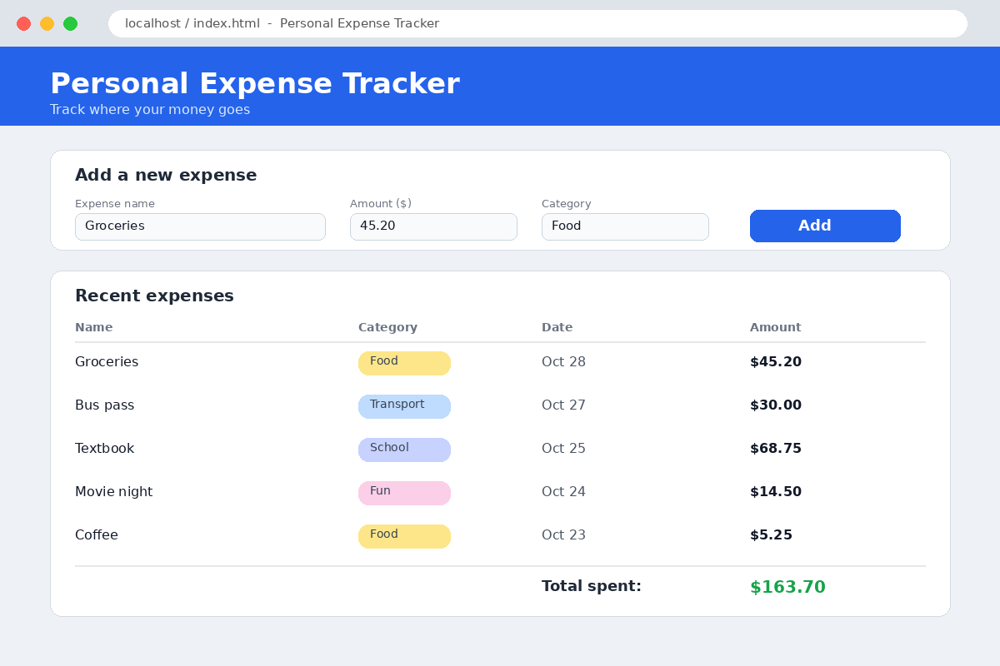

# IntroToGitHub

Version control in Github tracks changes to files /Code over time during the Project development, so you can review history, check mistakes, and work without overwriting your team member's work and then finally merging your work with the Main Project
This repository is my practice space for learning Git and GitHub.
As a Task , working on the Issues and how to Use and Merge it.

# Personal Expense Tracker

A simple web app for recording and viewing personal expenses, built with HTML, CSS, and a little JavaScript as my first GitHub project.

## Description

This project helps users:

- Add expenses with a name, amount, and category
- See a running total of spending
- Learn the basics of web development and Git/GitHub

> **Note:** This is a beginner project created for learning purposes.

## Technologies Used

| Technology | Purpose |
|---|---|
| HTML | Page structure |
| CSS | Styling and layout |
| JavaScript | Basic interactivity |

## Installation

1. Clone the repository:
   ```bash
   git clone git@github.com:YashG7378/IntroToGitHub.git
   ```
2. Move into the project folder:
   ```bash
   cd IntroToGitHub
   ```
3. Open `index.html` in your web browser.

## Usage

1. Enter the expense name and amount.
2. Choose a category.
3. Click **Add** to see it in the list.

## Screenshot



## Learning Goals

- [x] Create a GitHub repository
- [x] Write a README using Markdown
- [ ] Publish the site with GitHub Pages

## Author

**AG**, Computer Science student at CU Boulder

## Links

- [Markdown Guide](https://www.markdownguide.org/)
- [GitHub Docs](https://docs.github.com/)
